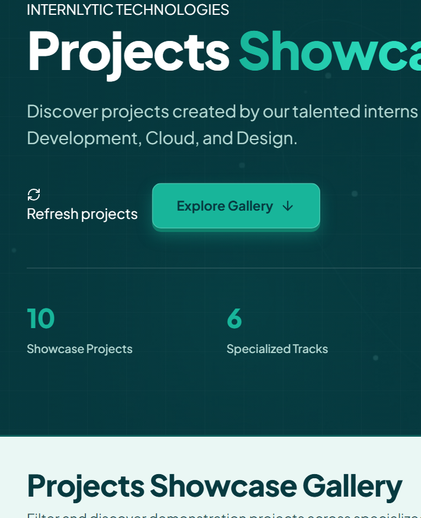
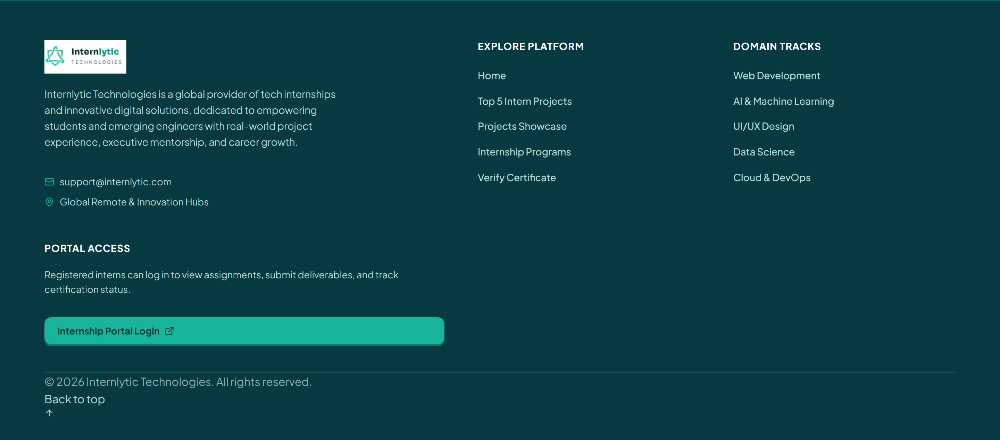

# Internlytic Projects Showcase — Production-Quality UI/UX Demonstration

> **Discover. Explore. Build.**  
> A high-performance, accessible, and dimensionally animated frontend demonstration of an internship project gallery built for **Internlytic Technologies**.
>
> 🔗 **Repository**: [https://github.com/Calipha-Rayyan/Internlytic-Projects-Showcase.git](https://github.com/Calipha-Rayyan/Internlytic-Projects-Showcase.git)

---

## 📌 Demonstration Overview & Scope

The **Internlytic Projects Showcase** is an independent, production-grade frontend demonstration that surfaces and celebrates projects engineered across internship tracks. It blends the official visual identity of Internlytic Technologies with modern 3D interactive web experiences, tactile micro-interactions, responsive accessibility, and clean component architecture.

### Key Architectural & Experience Features:
- **Authentic Brand Integration**: Official company logo with pixel-perfect dark theme rendering (`public/logo/internlytic-dark-transparent.png`) integrated seamlessly onto the `#073A40` header and footer with zero bounding-box artifacts.
- **Interactive 3D Project Stage**: Floating preview windows, parallax depth chips, concentric orbital rings, and pointer-responsive tilt physics.
- **Genuine Looping Video Animation**: High-quality 8-second 1280×720 WebM video loop (`public/videos/showcase-hero.webm`) with poster fallback and reduced-motion handling.
- **Tactile 3D Micro-Interactions**: Realistic button depression, 3D card tilt with specular glare overlays, and dynamic elevation shadows.
- **Floating 4D Back to Top Control**: Bottom-right floating dimensional box with isometric elevation, levitation animation (`float4DBox`), hover scale, scroll visibility listener (`>250px`), and smooth scroll restoration.
- **Dedicated Data Service Layer**: Clean asynchronous separation of concerns in [`src/services/projectService.js`](src/services/projectService.js).
- **Streamlined 3-Column Footer**: Authentic company logo, quick navigation links, and official resource channels with zero cluttered disclosure banners.
- **Redesigned Mobile Experience**: Compact sticky header with an accessible slide-down navigation drawer, non-clipped search bar, and zero horizontal overflow on 375px & 360px screens.
- **High-Contrast Modal Dialog**: Accessible project detail view with focus restoration, escape key dismissal, and verified tech tags.

---

## 🎨 Mandatory Brand Color System

The application strictly implements the official **Internlytic Technologies** color palette:

| Color Role | Hex Code | Visual Application |
| :--- | :--- | :--- |
| **Teal Green** | `#18B59A` | Primary actions, active filter pills, focus indicators, interactive accents, and highlights |
| **Deep Blue-Green** | `#073A40` | Sticky navigation header, hero background, headings, card borders, footer, and structure |
| **White** | `#FFFFFF` | Elevated project card surfaces, modal dialog canvas, and input backgrounds |
| **Light Background** | `#EAF7F4` | Main page canvas, supporting badges, pill containers, and subtle hover tints |

All tokens, spacing, typography scales, border radii, and motion curves are centrally controlled via CSS Custom Properties in [`src/styles/global.css`](src/styles/global.css).

---

## 📸 Interface Previews

All previews are captured directly from the running production build via automated headless browser tests in `public/screenshots/`:

| View | Description | Preview |
| :--- | :--- | :--- |
| **Hero & Gallery Grid** | Desktop view (1440px) featuring the balanced two-column hero, 3D interactive stage, authentic dark logo, and background video. |  |
| **Real-time Filtered State** | Instant search by title, intern, or technology combined with category track pills. |  |
| **Project Details Modal** | Accessible dialog displaying honest demo labelling, high-contrast close button, and stack details. |  |
| **Compact No-Results State** | Vertically balanced feedback card with pulsed icon and prominent reset action. |  |
| **Mobile Experience** | Mobile layout tested on 375px and 360px viewports with compact navigation and zero overflow. |  |
| **3D Card Hover Interaction** | Pointer-reactive 3D tilt with specular reflection and depth elevation. |  |
| **Footer & Floating 4D Button** | Clean 3-column dark brand footer and the floating 4D animated "Back to Top" button. |  |

---

## 🛠️ Technology Stack

- **Framework**: [React 18.3](https://react.dev/)
- **Bundler & Dev Server**: [Vite 6.0](https://vitejs.dev/)
- **Language**: JavaScript (ES2022+ Modules)
- **Styling Architecture**: Native CSS3 with CSS Custom Properties, 3D CSS Transforms (`preserve-3d`, `perspective`), Flexbox, and CSS Grid
- **Video & Graphics**: HTML5 Video (`.webm` + `.jpg` poster), HTML5 Canvas, SVG 16:9 Project Artwork
- **Icons**: [Lucide React](https://lucide.dev/)
- **Automated QA & Visual Capture**: [Puppeteer-Core](https://pptr.dev/) running against Google Chrome

---

## 📁 Project Architecture

```text
Internlytic-Projects-Showcase/
├── index.html                     # HTML5 entrypoint with Google Fonts and meta tags
├── package.json                   # Project dependencies and npm scripts
├── vite.config.js                 # Vite configuration
├── README.md                      # Comprehensive project documentation
├── .gitignore                     # Git ignore rules for node_modules, logs, and artifacts
├── public/
│   ├── logo/
│   │   ├── internlytic-dark-transparent.png  # Authentic dark logo with transparency
│   │   ├── internlytic-dark-logo.png         # Authentic dark logo on #073A40
│   │   ├── internlytic-logo.svg              # Brand logo vector
│   │   └── internlytic-mark.svg              # Brand icon / favicon
│   ├── videos/
│   │   ├── showcase-hero.webm     # 8s seamless looping abstract video background
│   │   └── showcase-hero-poster.jpg# Video poster frame / reduced-motion fallback
│   ├── images/
│   │   ├── projects/              # Custom vector thumbnails for sample projects
│   │   └── placeholders/
│   │       └── fallback.svg       # Image fallback handler
│   └── screenshots/               # Automated QA preview captures (7 test views)
├── scripts/
│   ├── generate-hero-video.js     # Script to render the 8s WebM video loop
│   └── verify-and-screenshot.js   # Automated headless browser test runner & QA suite
└── src/
    ├── main.jsx                   # React root entrypoint
    ├── App.jsx                    # Top-level state and layout container
    ├── data/
    │   └── sampleProjects.js      # Centralized sample demonstration records
    ├── services/
    │   └── projectService.js      # Asynchronous data loading and metrics service layer
    ├── hooks/
    │   └── useProjectFilters.js   # Custom React hook for search and filtering
    ├── components/
    │   ├── Navbar.jsx             # Sticky dark brand navbar with mobile drawer
    │   ├── Hero.jsx               # Two-column hero with video bg, stats & 3D button
    │   ├── Hero3DStage.jsx        # Interactive 3D project stage with pointer tilt
    │   ├── TopProjectsSection.jsx # Top intern projects highlight section
    │   ├── SearchBar.jsx          # Accessible 3D search bar with keyboard shortcut hint
    │   ├── FilterControls.jsx     # Tactile 3D track pills and tech dropdown
    │   ├── ProjectsGrid.jsx       # Responsive project cards grid with stagger
    │   ├── ProjectCard.jsx        # 3D interactive project card with pointer tilt & glare
    │   ├── ProjectDetailsModal.jsx# Accessible detail dialog with high contrast & 3D entrance
    │   ├── BackToTopButton.jsx    # Floating 4D animated box button with scroll listener
    │   ├── LoadingState.jsx       # Shimmer skeleton loader
    │   ├── EmptyState.jsx         # Compact empty repository and no-results UI
    │   ├── ErrorState.jsx         # Error state with retry action
    │   └── Footer.jsx             # Clean 3-column dark brand footer
    └── styles/
        ├── global.css             # Design tokens, reset, typography, and tactile buttons
        ├── components.css         # Component-specific 3D styles, 4D animations, and transitions
        └── responsive.css         # Breakpoints for 360px, 375px, 768px, 1024px, 1440px
```

---

## ⚡ Quickstart & Development Commands

### Installation
```bash
npm install
```

### Development Server
```bash
npm run dev
```
Open `http://localhost:5173` in your browser.

### Production Build
```bash
npm run build
```

### Automated QA & Verification
Run the automated headless browser test suite:
```bash
node scripts/verify-and-screenshot.js
```

---

## 📊 Honest Sample Data & Link Handling

- Dataset located in [`src/data/sampleProjects.js`](src/data/sampleProjects.js).
- All records are explicitly identified as **"Sample Project"** or **"Sample Demonstration Project"** to ensure complete transparency.
- External action buttons ("View Project" and "GitHub Repository") **only appear when a valid, non-empty URL exists**. They remain hidden for sample records where no public repository exists.
- **Strictly No Vanity Metrics**: No heart/like counters or fake ratings.

---

## 🔮 Future Supabase Integration Strategy (Documentation Only)

The showcase data layer has been structured cleanly inside [`src/services/projectService.js`](src/services/projectService.js). To connect to Supabase in a future phase:

1. **Proposed Database Schema**:
   ```sql
   CREATE TABLE showcase_projects (
     id UUID PRIMARY KEY DEFAULT gen_random_uuid(),
     project_title TEXT NOT NULL,
     intern_name TEXT NOT NULL,
     intern_id UUID REFERENCES auth.users(id),
     track TEXT NOT NULL,
     description TEXT NOT NULL,
     thumbnail_url TEXT,
     live_url TEXT,
     github_url TEXT,
     technologies TEXT[] NOT NULL DEFAULT '{}',
     approval_status TEXT NOT NULL DEFAULT 'Sample Project',
     created_at TIMESTAMPTZ NOT NULL DEFAULT now()
   );
   ```

2. **Row Level Security (RLS) Policy**:
   ```sql
   ALTER TABLE showcase_projects ENABLE ROW LEVEL SECURITY;
   CREATE POLICY "Allow public read access to approved projects"
     ON showcase_projects FOR SELECT USING (approval_status = 'approved');
   ```

3. **Client Adapter**: Replace `SAMPLE_PROJECTS` in `src/services/projectService.js` with `supabase.from('showcase_projects').select('*')`.

---

## ♿ Accessibility & Performance Verification

- **WCAG AAA Color Contrast**: Deep blue-green (`#073A40`) on white (`#FFFFFF`) exceeds 12:1; high-contrast "Close Details" action button features dark text on white with bold border (`#073A40`).
- **Keyboard Navigation**: Full tab sequence, visible 3px focus ring, `/` shortcut for search, and `Esc` to close modal and search input.
- **Focus Management**: Traps focus inside open modal and restores focus to opener element upon close.
- **Reduced Motion**: All continuous 3D tilt, video autoplay, and card animations are disabled when `prefers-reduced-motion: reduce` is detected.
- **Responsive Viewport Testing**: Verified across 360×640, 375×812, 768×1024, 1024×768, and 1440×900 with zero horizontal scroll or clipped text.

---

## 📄 License & Attribution

This demonstration project was engineered for the **Internlytic Technologies Internship Showcase Evaluation**. All branding guidelines adhere strictly to official company specifications.
