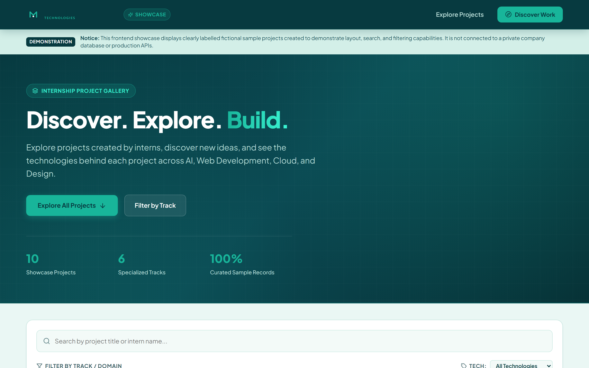
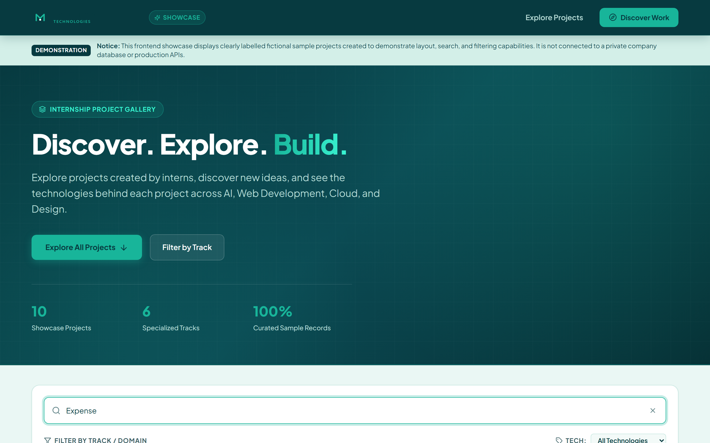
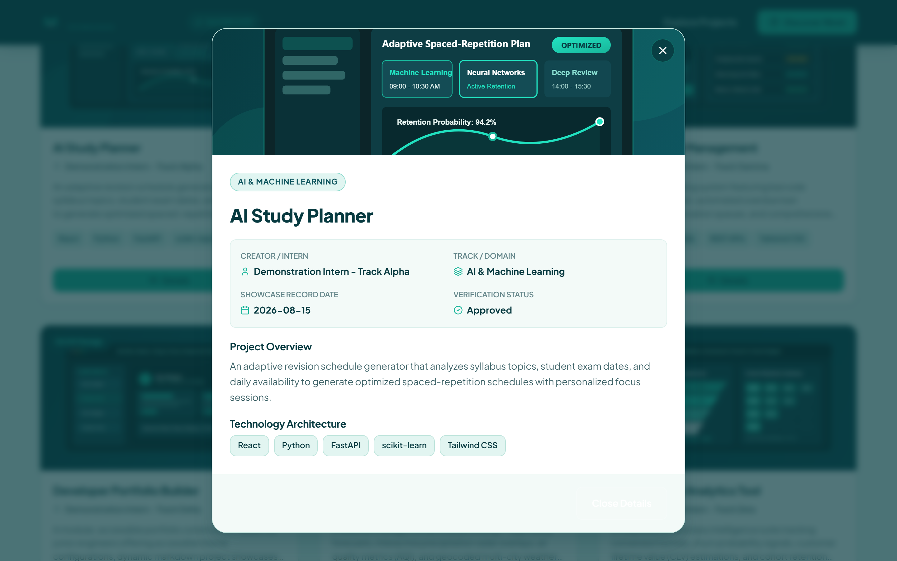
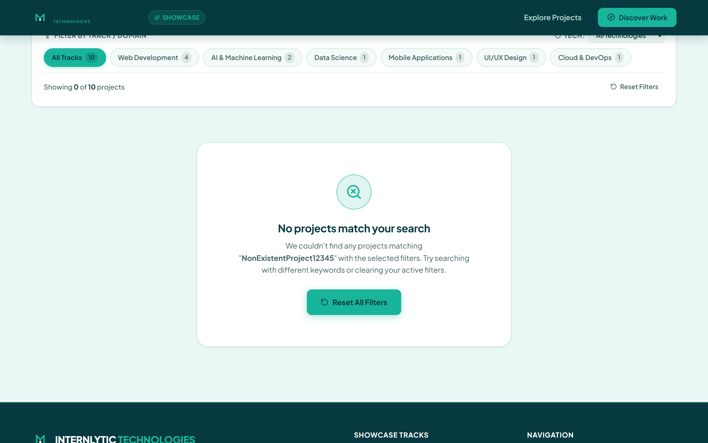
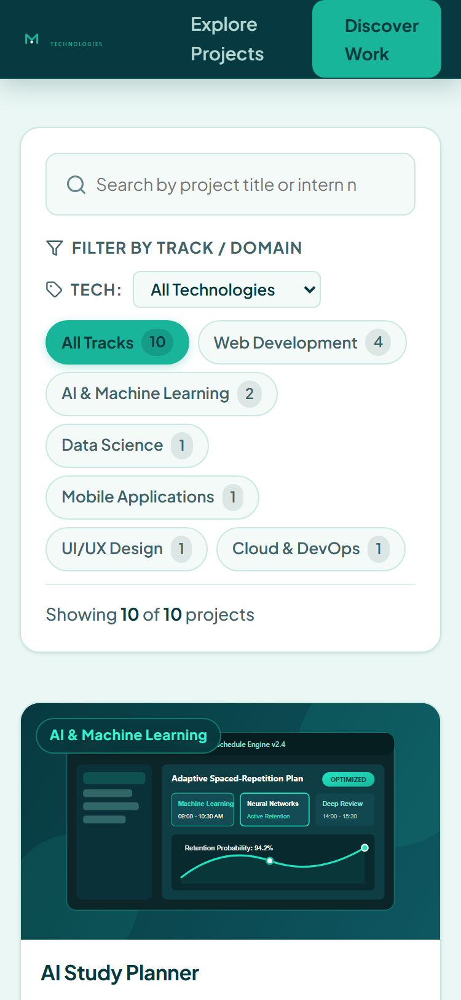

# Internlytic Projects Showcase

> **Discover. Explore. Build.**  
> A production-quality frontend demonstration of an internship project gallery built for **Internlytic Technologies**.

---

## 📌 Executive Summary & Demonstration Scope

The **Internlytic Projects Showcase** is an independent, high-performance frontend demonstration designed to celebrate and surface projects engineered across diverse internship tracks.

Visitors can seamlessly:
- Explore projects across six specialized tracks: **AI & Machine Learning**, **Web Development**, **Data Science**, **Mobile Applications**, **UI/UX Design**, and **Cloud & DevOps**.
- Search dynamically across project titles and intern names with real-time feedback.
- Filter projects by domain category and technical competencies with combined logic.
- Inspect full architectural details, creation dates, and technology stacks in an accessible modal dialog.
- Safely access validated project demonstrations and source code repositories when available.

> **Notice:** This application is an independent frontend demonstration created using clearly labelled sample data. It does not access private company databases, internal APIs, production websites, or private Supabase projects.

---

## 🎨 Visual Identity & Brand Design Tokens

The application strictly implements the official **Internlytic Technologies** color palette:

| Color Role | Hex Code | Visual Application |
| :--- | :--- | :--- |
| **Teal Green** | `#18B59A` | Primary actions, active filter pills, focus indicators, interactive accents, and highlights |
| **Deep Blue-Green** | `#073A40` | Sticky navigation header, hero gradient, headings, card borders, footer, and structure |
| **White** | `#FFFFFF` | Elevated project card surfaces, modal dialog canvas, and input backgrounds |
| **Light Background** | `#EAF7F4` | Main page canvas, supporting badges, pill containers, and subtle hover tints |

All tokens, spacing, typography scales, border radii, and motion curves are centrally controlled via CSS Custom Properties in [`src/styles/global.css`](file:///d:/Front-End%20Development%20Internship/Internlytic-Projects-Showcase/src/styles/global.css).

---

## 📸 Interface Previews

All previews are captured from the running production application in `public/screenshots/`:

| View | Description | Preview |
| :--- | :--- | :--- |
| **Hero & Gallery Grid** | Desktop view (1440px) with brand header, hero stats, search bar, and 3-column project cards. |  |
| **Real-time Filtered State** | Instant search by title or intern combined with track pills. |  |
| **Project Details Modal** | Accessible dialog displaying full description, metadata grid, tech tags, and links. |  |
| **No-Results State** | Helpful feedback with instant "Reset All Filters" action. |  |
| **Mobile Experience** | Tested and responsive layout for 360px and 375px mobile screens. |  |

---

## 🚀 Key Features

1. **Intelligent Search Engine**:
   - Searches project titles, intern creator names, and technologies.
   - Trims whitespace and ignores case differences.
   - Accessible clear button (`X`) with Escape key support.
2. **Category & Track Filtering**:
   - Track pills derived dynamically with live project counters.
   - Optional technology architecture selector.
   - Multi-criteria Boolean AND filtering.
3. **Curated Project Cards**:
   - 16:9 custom SVG project thumbnails designed for each demonstration domain.
   - Clean information hierarchy: category badge, title, intern name, description, and tech chips.
   - Conditional action buttons: "View Project" and "GitHub Repository" only render when a valid URL exists.
   - **No Heart / Like Counters**: Strictly compliant with project rules prohibiting vanity metrics.
4. **Accessible Project Details Modal**:
   - Keyboard accessible (`Esc` key to close, `Tab` focus trap).
   - Returns focus to the triggering element upon closing.
   - Body scroll locked when active to avoid disorientation.
   - Fully responsive for mobile viewports without clipping.
5. **Robust Gallery States**:
   - **Loading State**: Animated shimmer skeleton cards during initial data mount.
   - **Empty Gallery State**: Informative fallback if no records are supplied.
   - **No Search Results**: Friendly guidance with a single-click reset button.
   - **Error Handling**: Graceful error UI with a retry trigger.

---

## 🛠️ Technology Stack

- **Framework**: [React 18.3](https://react.dev/)
- **Bundler & Dev Server**: [Vite 6.0](https://vitejs.dev/)
- **Language**: JavaScript (ES2022+ Modules)
- **Styling Architecture**: Native CSS3 with CSS Variables, Flexbox, and CSS Grid (no heavy CSS frameworks)
- **Icons**: [Lucide React](https://lucide.dev/) (lightweight, SVG-based, accessible)
- **Typography**: Google Fonts (*Plus Jakarta Sans* & *JetBrains Mono*)
- **Automated QA & Visual Capture**: [Puppeteer-Core](https://pptr.dev/) running automated verification against Google Chrome

---

## 📁 Project Architecture

```text
Internlytic-Projects-Showcase/
├── index.html                     # HTML5 entrypoint with Google Fonts and meta tags
├── package.json                   # Project dependencies and npm scripts
├── vite.config.js                 # Vite configuration
├── README.md                      # Comprehensive project documentation
├── .gitignore                     # Git ignore rules for node_modules, logs, and artifacts
├── public/
│   ├── logo/
│   │   ├── internlytic-logo.svg   # Official brand logo vector
│   │   └── internlytic-mark.svg   # Brand icon / favicon
│   ├── images/
│   │   ├── projects/              # 10 custom vector thumbnails for sample projects
│   │   └── placeholders/
│   │       └── fallback.svg       # Image fallback handler
│   └── screenshots/               # Automated QA preview captures
├── scripts/
│   └── verify-and-screenshot.js   # Automated headless browser test runner
└── src/
    ├── main.jsx                   # React root entrypoint
    ├── App.jsx                    # Top-level state and layout container
    ├── data/
    │   └── sampleProjects.js      # Centralized sample demonstration records
    ├── hooks/
    │   └── useProjectFilters.js   # Custom React hook for search and filtering
    ├── components/
    │   ├── Navbar.jsx             # Sticky brand navigation header
    │   ├── NoticeBanner.jsx       # Restrained demonstration notice banner
    │   ├── Hero.jsx               # Hero section with stats & primary CTA
    │   ├── SearchBar.jsx          # Accessible search bar with reset
    │   ├── FilterControls.jsx     # Track pills and technology filter
    │   ├── ProjectsGrid.jsx       # Responsive 3-column project cards grid
    │   ├── ProjectCard.jsx        # Individual project card surface
    │   ├── ProjectDetailsModal.jsx# Accessible detail dialog with focus trap
    │   ├── LoadingState.jsx       # Shimmer skeleton loader
    │   ├── EmptyState.jsx         # Empty repository and no-results UI
    │   ├── ErrorState.jsx         # Error state with retry action
    │   └── Footer.jsx             # Brand footer with navigation & copyright
    └── styles/
        ├── global.css             # Design tokens, reset, typography, and accessibility
        ├── components.css         # Component-specific styles
        └── responsive.css         # Breakpoints for 360px, 375px, 768px, 1024px, 1440px
```

---

## ⚡ Quickstart & Development Commands

### Prerequisites
- **Node.js**: v18.0.0 or later (tested on Node v22)
- **npm**: v9.0.0 or later

### Installation
Clone or navigate to the repository directory and install dependencies:
```bash
npm install
```

### Development Server
Start the local Vite development server with Hot Module Replacement (HMR):
```bash
npm run dev
```
Open `http://localhost:5173` in your browser.

### Production Build
Compile and bundle optimized production assets into the `dist/` folder:
```bash
npm run build
```

### Preview Production Build
Preview the generated production build locally:
```bash
npm run preview
```

---

## 📊 Sample Data Architecture

The dataset is centrally located in [`src/data/sampleProjects.js`](file:///d:/Front-End%20Development%20Internship/Internlytic-Projects-Showcase/src/data/sampleProjects.js).

Each record adheres to the following structured schema:

```javascript
{
  id: "proj-001",
  projectTitle: "AI Study Planner",
  internName: "Demonstration Intern - Track Alpha",
  track: "AI & Machine Learning",
  description: "An adaptive revision schedule generator...",
  thumbnailUrl: "/images/projects/ai-study-planner.svg",
  liveUrl: null,       // Kept null if no public demo exists
  githubUrl: null,     // Kept null if no public repo exists
  technologies: ["React", "Python", "FastAPI", "scikit-learn"],
  approvalStatus: "approved",
  createdAt: "2026-08-15"
}
```

### Link Handling Integrity
- Action buttons for external demos ("View Project") and source code ("GitHub Repository") **only appear when a valid, non-empty URL exists**.
- For demonstration records without public repositories, the values are kept `null` to avoid broken external navigation or fabricated URLs.
- To add real internship projects in the future, simply update the entries in `src/data/sampleProjects.js`.

---

## 🔮 Future Supabase Integration Strategy (Documentation Only)

The current application is a **standalone frontend demonstration** using local sample data. To connect this showcase to a live backend database such as Supabase in the future, follow this recommended architectural blueprint:

### 1. Database Table Structure (Proposed)
```sql
-- Proposed schema for approved showcase projects
CREATE TABLE showcase_projects (
  id UUID PRIMARY KEY DEFAULT gen_random_uuid(),
  project_title TEXT NOT NULL,
  intern_name TEXT NOT NULL,
  intern_id UUID REFERENCES auth.users(id),
  track TEXT NOT NULL,
  description TEXT NOT NULL,
  thumbnail_url TEXT,
  live_url TEXT,
  github_url TEXT,
  technologies TEXT[] NOT NULL DEFAULT '{}',
  approval_status TEXT NOT NULL DEFAULT 'pending' CHECK (approval_status IN ('pending', 'approved', 'rejected')),
  created_at TIMESTAMPTZ NOT NULL DEFAULT now(),
  updated_at TIMESTAMPTZ NOT NULL DEFAULT now()
);
```

### 2. Row Level Security (RLS) Access Policy
Public read access should be restricted strictly to **company-approved** projects:
```sql
ALTER TABLE showcase_projects ENABLE ROW LEVEL SECURITY;

-- Allow anonymous and authenticated visitors to read only approved projects
CREATE POLICY "Public visitors can only view approved projects"
  ON showcase_projects
  FOR SELECT
  USING (approval_status = 'approved');
```

### 3. Frontend Data Client Service
A dedicated API service module (e.g., `src/services/projectsService.js`) would replace the static import:
```javascript
import { createClient } from '@supabase/supabase-js';

const supabaseUrl = import.meta.env.VITE_SUPABASE_URL;
const supabaseAnonKey = import.meta.env.VITE_SUPABASE_ANON_KEY;

export const supabase = createClient(supabaseUrl, supabaseAnonKey);

export async function fetchApprovedProjects() {
  const { data, error } = await supabase
    .from('showcase_projects')
    .select('*')
    .order('created_at', { ascending: false });

  if (error) throw error;
  return data;
}
```

> **Security Note:** Never commit secret service keys to version control. The client application should only ever use the public anonymous key (`VITE_SUPABASE_ANON_KEY`) with RLS policies properly enforced.

---

## ♿ Accessibility & Responsiveness Audit

- **Color Contrast**: All text elements exceed WCAG 2.1 AA requirements (deep blue-green `#073A40` on white `#FFFFFF` provides a contrast ratio of > 12:1; teal `#18B59A` on `#073A40` provides > 4.5:1).
- **Keyboard Navigation**: Full tab order and visible 3px focus rings on all interactive elements. Modals include `Escape` key close handlers and focus trapping.
- **Screen Reader Support**: Semantic landmarks (`<header>`, `<main>`, `<article>`, `<footer>`, `<aside>`, `role="search"`, `role="dialog"`). Clear input labels and `aria-hidden` attributes on decorative icons.
- **Responsive Viewport Testing**: Verified across 360px, 375px, 768px, 1024px, and 1440px without horizontal overflow, text clipping, or broken layouts.
- **Reduced Motion**: Honored via `@media (prefers-reduced-motion: reduce)` in `global.css`.

---

## 📝 Known Limitations

1. **Demonstration Dataset**: Projects and intern creators are fictional representations created to showcase frontend features.
2. **Offline-First / Local Only**: No live database connectivity is active in this release by design.
3. **Repository Links**: Sample records have `null` external links by default to prevent navigation to nonexistent repositories.

---

## 📄 License & Attribution

This demonstration project was engineered for the **Internlytic Technologies Internship Showcase Evaluation**. All branding guidelines and color tokens adhere to official company specifications.
